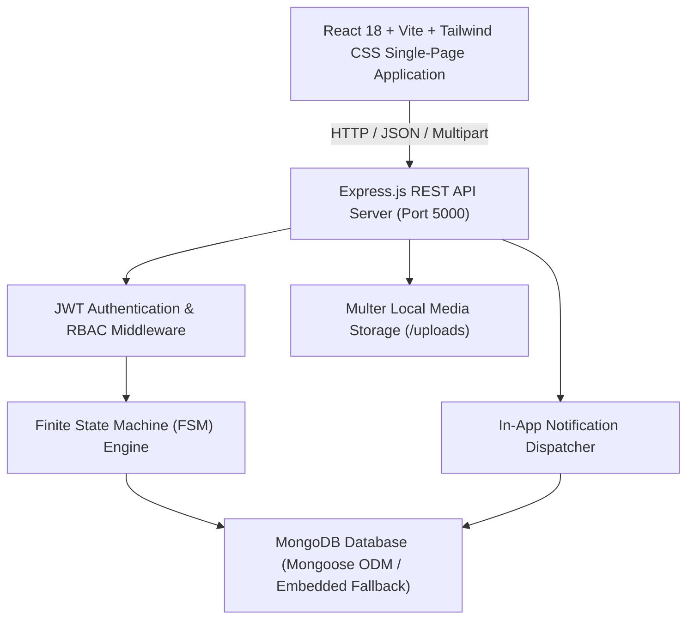
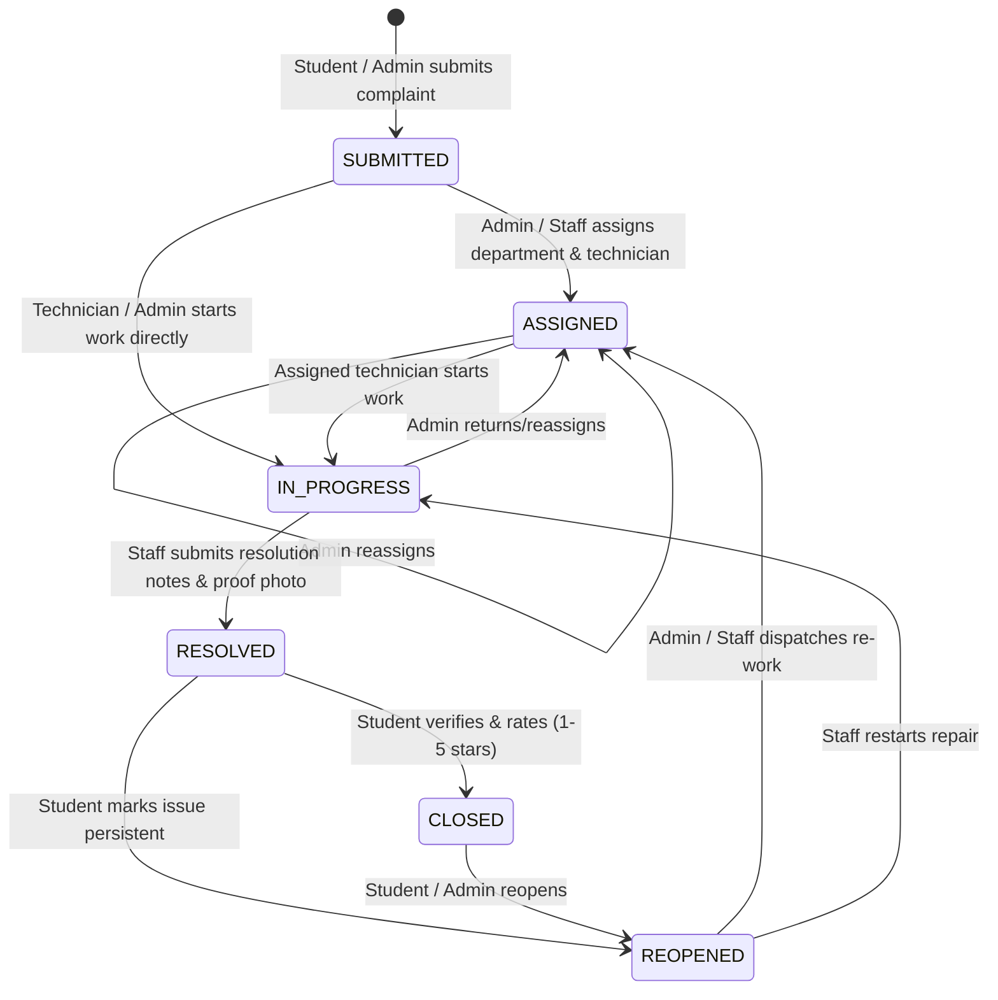

# CampusFlow Architecture & Engineering Specification

## 1. System Overview

**CampusFlow** is a full-stack smart campus infrastructure and issue management platform designed to streamline facility maintenance, student complaint tracking, staff assignment, and administrative SLA governance.

---

## 2. Finite State Machine (FSM) State Transition Engine

The core technical differentiator of CampusFlow is a backend-enforced Finite State Machine governing the complaint lifecycle. Unpermitted transitions are rejected with HTTP 400 and descriptive rejection reasons, preventing privilege escalation.

### Permitted Transitions Matrix

| Source Status | Target Status | Authorized Roles | Pre-conditions |
|---|---|---|---|
| `SUBMITTED` | `ASSIGNED` | `admin`, `staff` | Department selected |
| `SUBMITTED` | `IN_PROGRESS` | `admin`, `staff` | Staff belongs to department |
| `ASSIGNED` | `IN_PROGRESS` | `admin`, `staff` | Staff assigned or in department |
| `ASSIGNED` | `RESOLVED` | `admin`, `staff` | Resolution notes required |
| `IN_PROGRESS` | `RESOLVED` | `admin`, `staff` | Resolution notes + optional proof photo |
| `RESOLVED` | `CLOSED` | `student` (creator), `admin` | Satisfaction rating (1-5) and feedback |
| `RESOLVED` | `REOPENED` | `student` (creator), `admin` | Reopen explanation required |
| `CLOSED` | `REOPENED` | `student` (creator), `admin` | Reopen explanation required |

---

## 3. Role-Based Access Control (RBAC) Matrix

| Feature / Resource | Student | Staff / Technician | Administrator |
|---|:---:|:---:|:---:|
| **Submit Complaint** | Yes | Yes | Yes |
| **View Own Complaints** | Yes | Yes | Yes |
| **View All Campus Complaints** | Scope-restricted | Department / Assigned | Full Campus |
| **Assign / Reassign Staff** | No | No | Yes |
| **Transition to IN_PROGRESS** | No | Yes (assigned) | Yes |
| **Transition to RESOLVED** | No | Yes (with notes) | Yes |
| **Confirm & Rate (CLOSE)** | Yes (creator) | No | Yes |
| **Reopen Complaint** | Yes (creator) | No | Yes |
| **View System Analytics & SLA** | No | Department Stats | Full Analytics |
| **Audit Logs Access** | No | No | Yes |

---

## 4. SLA & Urgency Engine

CampusFlow automatically computes SLA resolution deadlines at ticket creation time based on the selected urgency:

$$\text{SLA Deadline} = \text{Creation Timestamp} + \text{SLA Hours}(\text{Priority})$$

- **CRITICAL / Hazard**: 12 Hours target resolution
- **HIGH**: 24 Hours target resolution
- **MEDIUM**: 48 Hours target resolution
- **LOW**: 72 Hours target resolution

A virtual field `isOverdue` dynamically compares current time or resolution timestamp against the deadline to flag breached tickets.

---

## 5. Database Schema & Data Models

### 1. `User` Model
- `name` (String, required)
- `email` (String, unique, lowercase, required)
- `password` (String, hashed via bcryptjs with salt round 10)
- `role` (Enum: `student`, `staff`, `admin`)
- `department` (Enum: `Electrical`, `Plumbing`, `IT & Network`, `Housekeeping`, `Carpentry`, `Civil`, `General Administration`)
- `hostelOrRoom` (String)
- `studentId` (String)
- `phone` (String)

### 2. `Complaint` Model
- `ticketNumber` (String, indexed, formatted: `CF-YYYYMMDD-XXXX`)
- `title` (String, required)
- `description` (String, required)
- `category` (Enum: `Hostel`, `Classroom`, `Wi-Fi & Network`, `Electrical`, `Plumbing`, `Housekeeping`, `Carpentry`, `Lab & Equipment`, `Civil & Infrastructure`, `Other`)
- `location`: `{ zone, building, roomNumber }`
- `priority` (Enum: `LOW`, `MEDIUM`, `HIGH`, `CRITICAL`)
- `status` (Enum: `SUBMITTED`, `ASSIGNED`, `IN_PROGRESS`, `RESOLVED`, `CLOSED`, `REOPENED`)
- `createdBy` (ObjectId $\rightarrow$ User)
- `assignedDepartment` (String)
- `assignedTo` (ObjectId $\rightarrow$ User)
- `images` ([String URLs])
- `resolution`: `{ notes, proofImage, resolvedAt, resolvedBy }`
- `feedback`: `{ rating: 1-5, comment, submittedAt }`
- `slaDeadline` (Date)
- `timeline`: `[ { status, changedBy, note, timestamp } ]`
- `reopenReason` (String)

### 3. `Notification` Model
- `recipient` (ObjectId $\rightarrow$ User)
- `title`, `message`, `type` (`STATUS_CHANGE`, `ASSIGNED`, `FEEDBACK`, `SLA_ALERT`)
- `complaint` (ObjectId $\rightarrow$ Complaint)
- `isRead` (Boolean)

### 4. `AuditLog` Model
- `action`, `performedBy`, `userRole`, `entityId`, `previousState`, `newState`, `metadata`, `createdAt`
